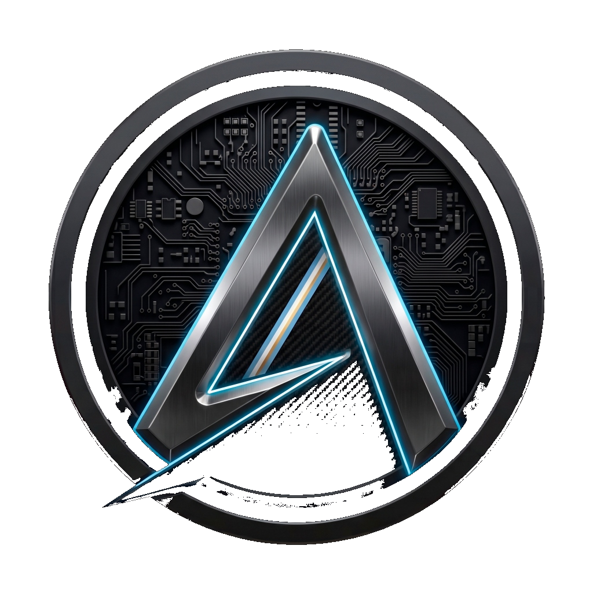

<p align="center">
  
</p>

<h1 align="center">AntarTech Control Hub</h1>

<p align="center">
  <strong>Software oficial de calibración y diagnóstico para hardware de simracing Antartech y dispositivos DirectInput.</strong>
</p>

<p align="center">
  
  
  
  
  
</p>

---

## 🏎️ Acerca de AntarTech Control

**AntarTech Control** es una suite de calibración de alta precisión diseñada para pedaleras con celda de carga, frenos de mano analógicos, botoneras y volantes de simracing.

Construida con una arquitectura de código abierto, transparente y liviana, ofrece una lectura nativa de hardware a 120Hz mediante DirectInput sin intermediarios ni controladores intrusivos.

### ✨ Características Principales

* ⚡ **Lectura Nativa DirectInput a 120Hz**: Compatible con hardware Antartech (RP2040/STM32) y periféricos de Logitech, Fanatec, Moza, Thrustmaster y pedales DIY.
* 🎯 **Calibración Precisa de Ejes**: Configuración de topes mínimos, máximos, centros, zonas muertas internas/externas e inversión de ejes.
* 📈 **Curvas de Respuesta y Filtrado EMA**: Curvas de sensibilidad personalizables y suavizado de señal por media móvil exponencial para celdas de carga y potenciómetros.
* 💾 **Inyección Global en el Registro de Windows**: Aplica la calibración directamente en `DIOBJECTCALIBRATION` para que todos los simuladores (iRacing, Assetto Corsa, EA Sports WRC, rFactor 2, Automobilista 2) la reconozcan al instante sin necesidad de software virtual como vJoy.
* 🔒 **Transparente y Confiable**: Sin procesos ocultos en segundo plano, sin servicios persistentes en el inicio de Windows y sin telemetría invasiva.
* 🌐 **Soporte Multilingüe**: Interfaz disponible en Español, Inglés y Portugués.

---

## 📥 Descarga e Instalación

Puedes descargar el instalador oficial desde nuestro sitio web o desde la sección de Releases:

* **Sitio Web Oficial**: [antartech.com.ar](https://antartech.com.ar)
* **Descarga Directa**: [AntarTechControl_Setup_v1.0.0.exe](https://antartech.com.ar/descargas/AntarTechControl_Setup_v1.0.0.exe)

El instalador es completamente **autocontenido**: no requiere instalar previamente .NET Runtime ni dependencias adicionales.

---

## 🛠️ Compilación desde el Código Fuente

### Requisitos:
* Windows 10 / 11 (64 bits)
* [.NET 8.0 SDK](https://dotnet.microsoft.com/download/dotnet/8.0)
* [Inno Setup 6](https://jrsoftware.org/isdl.php) (opcional, para compilar el instalador)

### Pasos:

```bash
# 1. Clonar el repositorio
git clone https://github.com/Antarestai/AntarTechControlHub.git
cd AntarTechControlHub

# 2. Restaurar dependencias y compilar
dotnet build -c Release

# 3. Ejecutar la aplicación
dotnet run -c Release

# 4. Generar el instalador (opcional con Inno Setup)
dotnet publish -c Release -r win-x64 --self-contained true /p:PublishSingleFile=true -o "bin\Publish"
iscc "AntarTechControl_Installer.iss"
```

---

## 🛡️ Seguridad y Verificación

| Archivo | Hash SHA-256 |
|---|---|
| `AntarTechControl_Setup_v1.0.0.exe` | `01F135889329FDE21B8B89323E58C288E25165704CC0B09FEF014AC280AC3A47` |

---

## 📄 Licencia

Este proyecto está licenciado bajo la filosofía de software de código abierto para la comunidad simracing.  
Desarrollado con pasión por **Antartech Simracing**.
